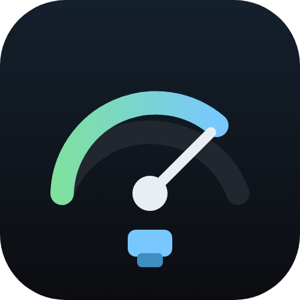
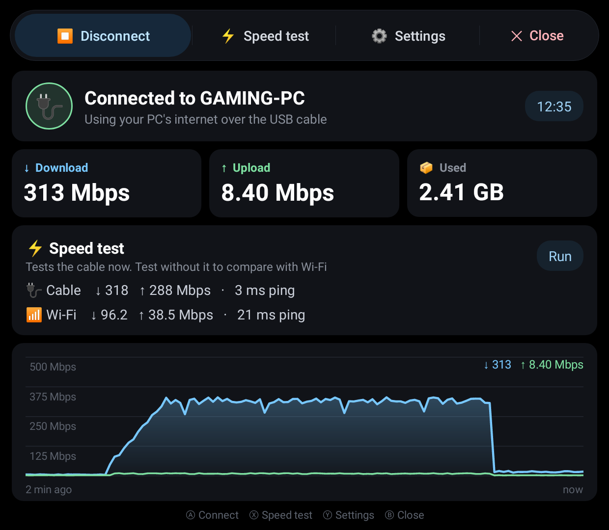
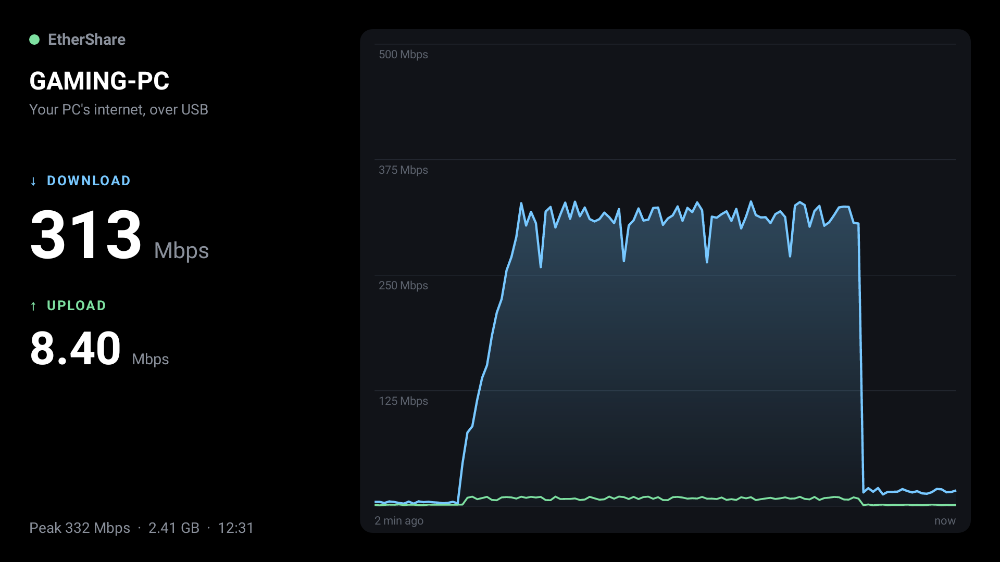
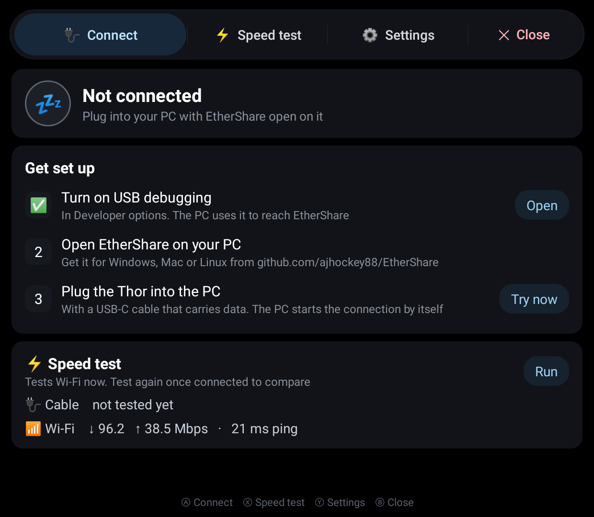
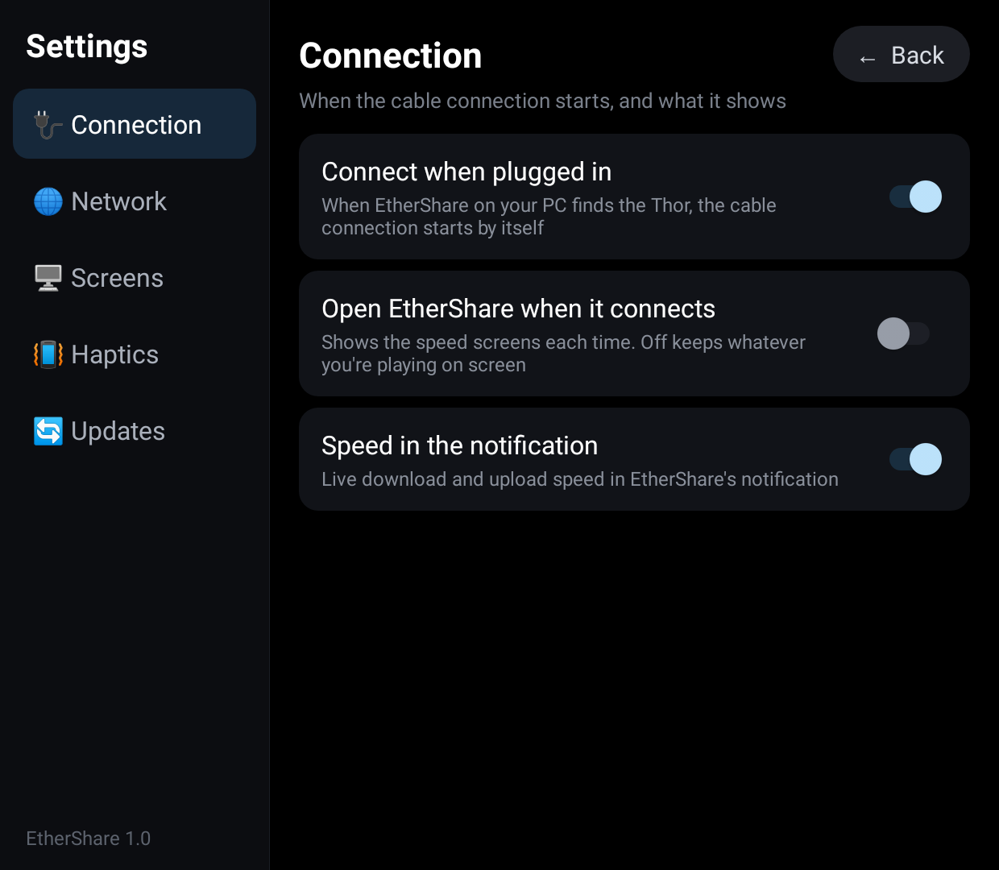
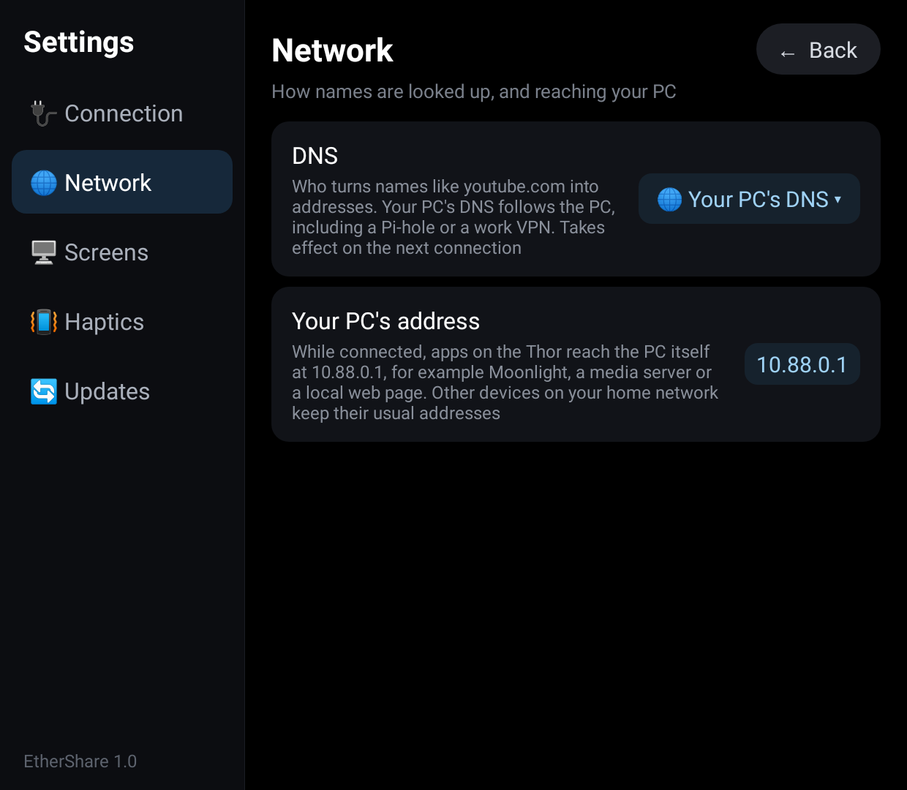
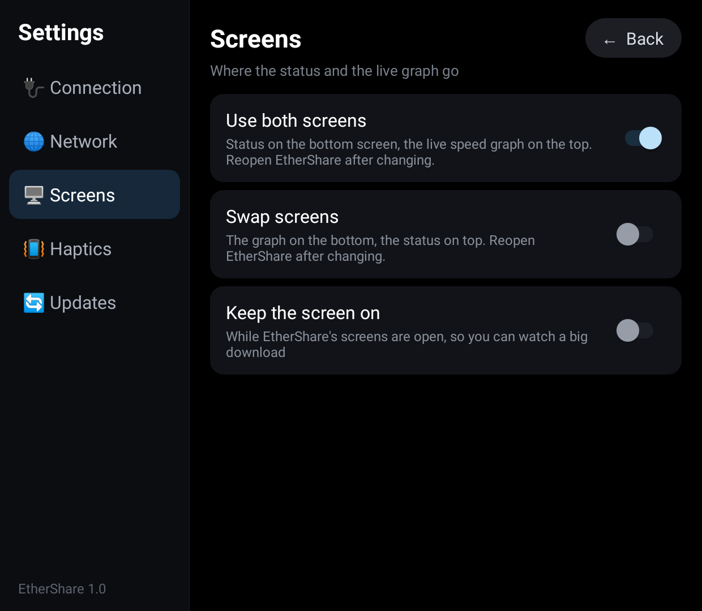
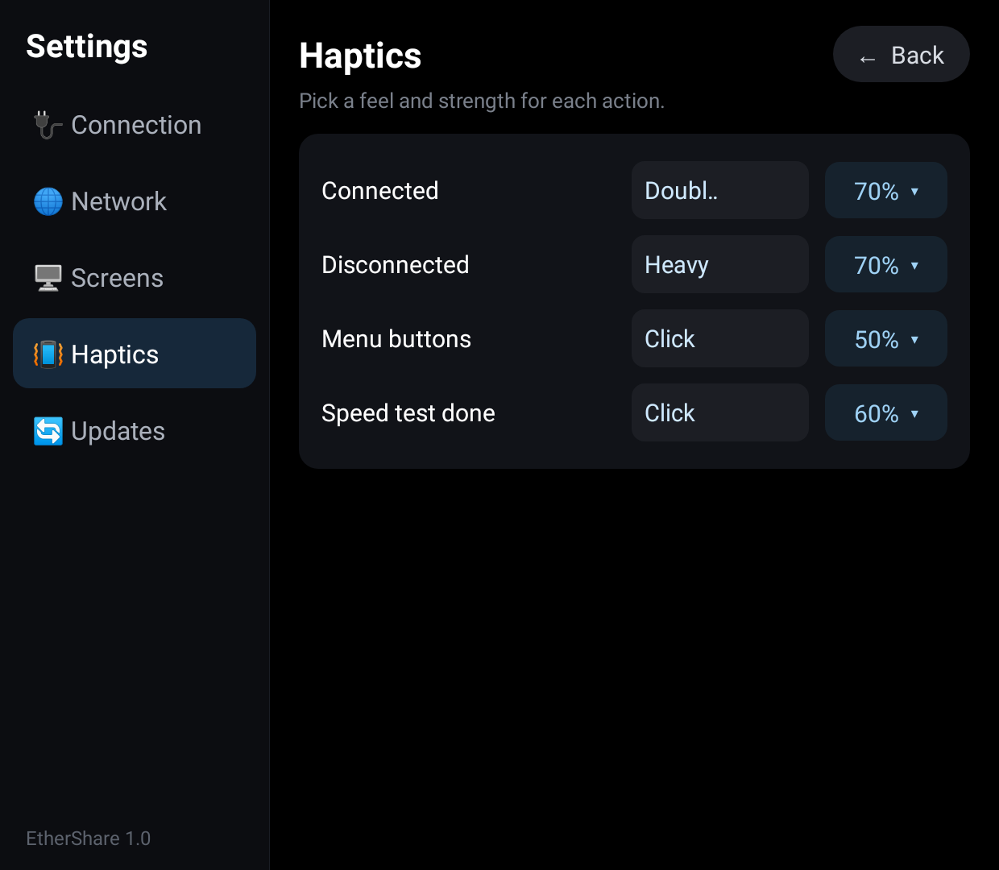
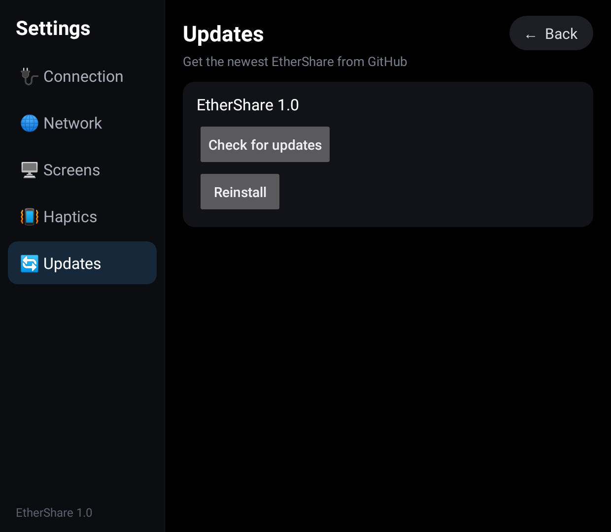

# EtherShare

🔌 Your PC's wired internet on the AYN Thor, over the USB-C cable.

🚀 Plug the Thor into your PC and it uses the PC's ethernet connection instead of Wi-Fi: steadier
speeds and pings for big game downloads, cloud gaming and streaming from your PC. No root, no
drivers to install, and no network settings to change on the PC.

## 📸 Screens

| 🔌 Connected (bottom screen) | 📈 Live speed (top screen) |
|---|---|
|  |  |
| 🧭 Getting set up | 🔌 Settings: Connection |
|  |  |
| 🌐 Settings: Network | 🖥️ Settings: Screens |
|  |  |
| 📳 Settings: Haptics | 🔄 Settings: Updates |
|  |  |

The screenshots are drawn from the app's own code with made-up speeds; pictures from a Thor will
replace them.

- 🔌 **Plug in and go:** EtherShare on the PC spots the Thor when the cable goes in and starts the
  connection by itself. Unplug and the Thor goes back to Wi-Fi.
- 📈 **Live speeds:** download and upload speed, data used and time connected on the bottom
  screen, a big two-minute graph on the top screen, and the speed in the notification.
- ⚡ **Speed test:** ping, download and upload, with the last cable result and the last Wi-Fi
  result side by side so you can see the difference.
- 🖥️ **Reach your PC:** while connected, the PC itself is at `10.88.0.1` (for Moonlight, a media
  server or anything else running on it), and the rest of your home network works as usual.
- 🌐 **DNS your way:** the PC's own DNS (so a Pi-hole or a work VPN on the PC applies to the Thor
  too), or Cloudflare, Google or Quad9.

## 👆 Using it

Plug the Thor into the PC with EtherShare running on the PC. That's it: the first time, Android
asks to allow EtherShare's VPN; after that it connects by itself whenever you plug in.

Closing EtherShare only closes its screens: the connection keeps running in the background, so
every app on the Thor uses the cable until you unplug or tap **Disconnect**.

The bar along the top has 🔌 **Connect** / ⏹️ **Disconnect**, ⚡ **Speed test**, ⚙️ **Settings** and
✖️ **Close**. The notification has a **Disconnect** button too.

🎮 **Gamepad:** **A** connects or disconnects, **X** runs the speed test, **Y** (or Start) opens
Settings, **B** closes.

**How fast is it?** As fast as the USB link and adb allow. adb sends data in pieces and waits for
each to arrive before sending the next, which holds a single adb connection to around 90 Mbps,
so EtherShare uses 8 of them at once. The PC side alone moves several Gbps in tests, so it's
never the limit. Use a USB 3 port and a cable that carries data (not a charge-only cable).

## ⚙️ Settings

- 🔌 **Connection:** connect when plugged in (on by default), open EtherShare's screens each time it
  connects (off by default, so whatever you're playing stays on screen), and the speed in the
  notification
- 🌐 **Network:** DNS (your PC's, Cloudflare, Google or Quad9), and the PC's address while connected
- 🖥️ **Screens:** use both screens (status on the bottom, graph on top), swap screens, and keep the
  screen on while EtherShare is open
- 📳 **Haptics:** a feel (Off, Tick, Click, Heavy, Double or Buzz) and strength for connecting,
  disconnecting, the menu buttons and the speed test finishing
- 🔄 **Updates:** **Check for updates** and **Reinstall**, as in ThorPad: finds a newer EtherShare
  release on GitHub, shows what's new, then downloads and installs it (silently with Shizuku,
  otherwise with Android's install prompt). EtherShare also checks quietly each time it opens
  and only says something when there's a new version.

## 📲 Install

**On the Thor**

1. Copy `EtherShare.apk` to the Thor and open it to install.
2. Turn on **USB debugging**: Settings > About > tap **Build number** 7 times, then Settings >
   System > Developer options > **USB debugging**. (EtherShare's setup card has a button for it.)

**On the PC** (Windows, Mac or Linux), from [Releases](https://github.com/ajhockey88/EtherShare/releases/latest):

| PC | Download | Then |
|---|---|---|
| 🪟 Windows | `EtherShare-Windows.exe` | Double-click it. If SmartScreen warns, choose **More info > Run anyway** |
| 🍎 Mac (M1 or newer) | `EtherShare-Mac-AppleSilicon.zip` | Unzip, then right-click `EtherShare` > **Open** the first time |
| 🍎 Mac (Intel) | `EtherShare-Mac-Intel.zip` | Same as above |
| 🐧 Linux | `EtherShare-Linux.zip` | Unzip and run `./EtherShare` |

The first time, it downloads Google's `adb` (about 7 MB) if the PC doesn't have it already. Put
`EtherShare.apk` in the same folder and the PC installs the app on the Thor for you when you plug
it in.

**Then plug in.** Tap **Allow** on the Thor's "Allow USB debugging?" prompt (tick "Always allow
from this computer"), then **OK** on the VPN prompt. Leave the PC window open while you use it.

🔄 **Updating:** tap **Check for updates** in Settings, or install the newest `EtherShare.apk` from
[Releases](https://github.com/ajhockey88/EtherShare/releases) over the old one. Update the PC
program at the same time: older and newer versions still work together, but the newest speed-ups
need both.

**If it doesn't connect:** make sure the PC window says it found the Thor. If a Windows PC never
finds it, Windows is missing an ADB driver for the Thor; Google's
[USB driver](https://developer.android.com/studio/run/win-usb) usually fixes that.
Only one app can be the VPN at a time, so turn off any other VPN on the Thor.

## 🛠️ How it works

Android doesn't let an app use a PC's network over USB directly, so EtherShare carries the
Thor's traffic through **adb**, the developer connection that USB debugging turns on:

1. The PC program runs `adb reverse`, which opens a private socket on the Thor that leads to the
   PC program, then asks the app to connect.
2. The app starts a VPN (all on the Thor, nothing leaves it). Every packet Thor apps send goes
   into the VPN, and EtherShare passes it, unchanged, down the cable.
3. The PC program feeds the packets into a user-space TCP/IP stack
   ([gVisor's netstack](https://gvisor.dev/)), which opens a normal connection from the PC for
   each one, so the traffic goes out over the PC's ethernet like any other PC app. Replies come
   back the same way.

Because the PC makes ordinary connections, it needs no admin rights, drivers or network sharing
settings. The VPN uses 16 KB packets to cut the per-packet cost over adb, and only talks to adb
itself: the app checks that whatever answers on the socket is adb before sending anything.

adb carries each connection stop-and-wait (a piece, then a wait for the go-ahead), so one
connection on its own is slow. The app opens 8 and both sides deal the packets across them in
turn, numbered, and put them back in order on arrival: the waits overlap, and even one big
download gets the speed of all 8.

The PC program is in [`desktop/`](desktop) (Go); the Android app is in [`app/`](app).

🔒 EtherShare has no servers and no tracking. Your traffic goes from the Thor through the cable
to your own PC and out through its connection, nowhere else. The app also checks GitHub for
updates when it opens, and contacts Tele2's public speed test server (and 1.1.1.1 for the ping) only when you run a speed
test. The PC program only goes online to download `adb` the first time, if it's missing.

## 🙏 Credits

- [gVisor](https://github.com/google/gvisor) (Apache 2.0) provides the TCP/IP stack in the PC program.
- The idea of reverse tethering over `adb reverse` comes from Genymobile's
  [gnirehtet](https://github.com/Genymobile/gnirehtet).

## 🏗️ Building

`./build.sh` builds `build/EtherShare.apk` with Ubuntu's packaged Android tools (see the script
header); it downloads the two jars it compiles against from Maven Central. The project also has
standard Gradle files, so it can be opened and built in Android Studio.

`desktop/build.sh` builds the PC program for Windows, macOS and Linux into `desktop/dist/` (needs
[Go](https://go.dev/dl/)). `cd desktop && go test ./...` runs the tunnel tests: a simulated Thor
downloads and uploads through the relay over 8 streams, through a simulated stop-and-wait adb
link (where 8 streams must beat 1), and over the old single-stream protocol; it also checks
that DNS goes to the PC's resolver and that refused connections fail fast.

The signing key is not in this repository. `build.sh` reads it from `keystore/ethershare.jks`
(or `$KEYSTORE`) and creates a new one if missing; an APK signed with a different key has to be
uninstalled before it can replace an older install.

### Releasing

Bump `versionCode` and `versionName` in `app/build.gradle` and `AndroidManifest.xml` and build
with the usual key. Then commit `release/EtherShare.apk` and `release/notes.md` on top of `main`
and push that commit as a `release/v1.1` branch (not to `main`). The Release workflow builds the
PC program, tags the commit `v1.1`, publishes the release with the APK and the PC downloads, and
deletes the branch; the app's Check for updates finds it.

## 📄 License

EtherShare's code is released under the [MIT License](LICENSE). The PC program includes
[gVisor](https://github.com/google/gvisor), which keeps its own Apache 2.0 license (see 🙏 Credits).
